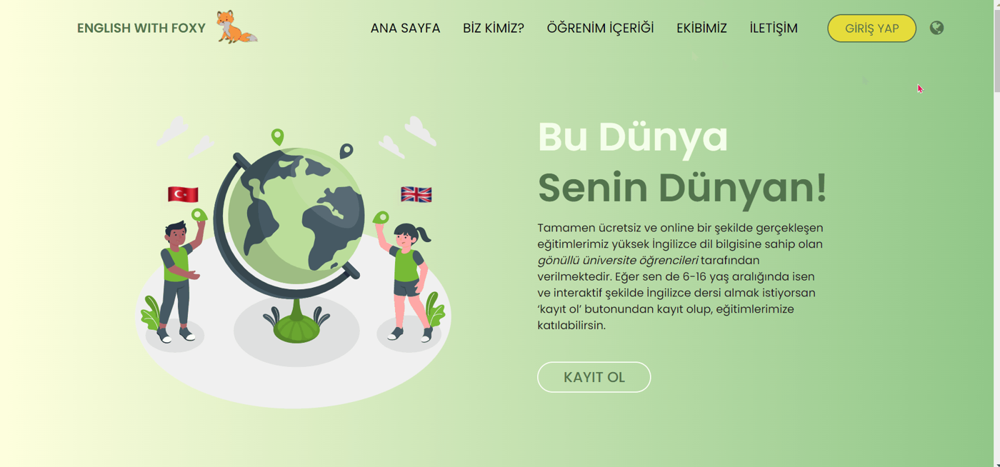
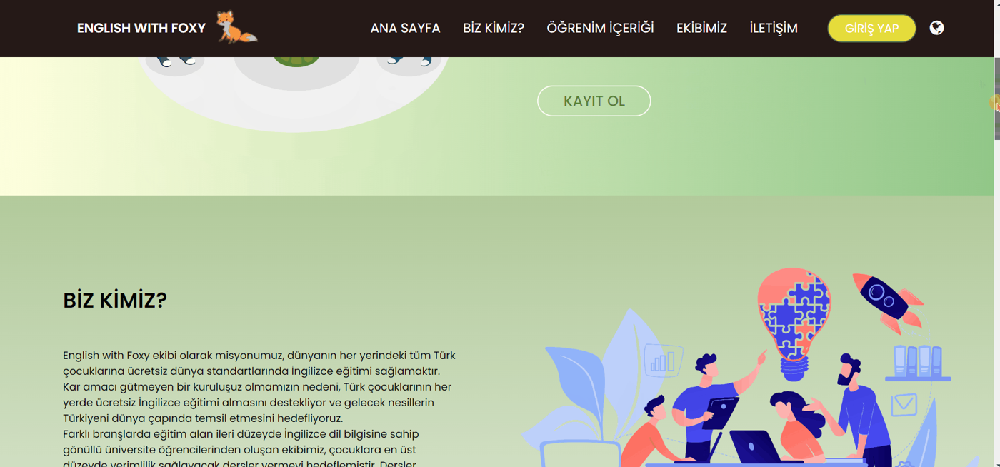
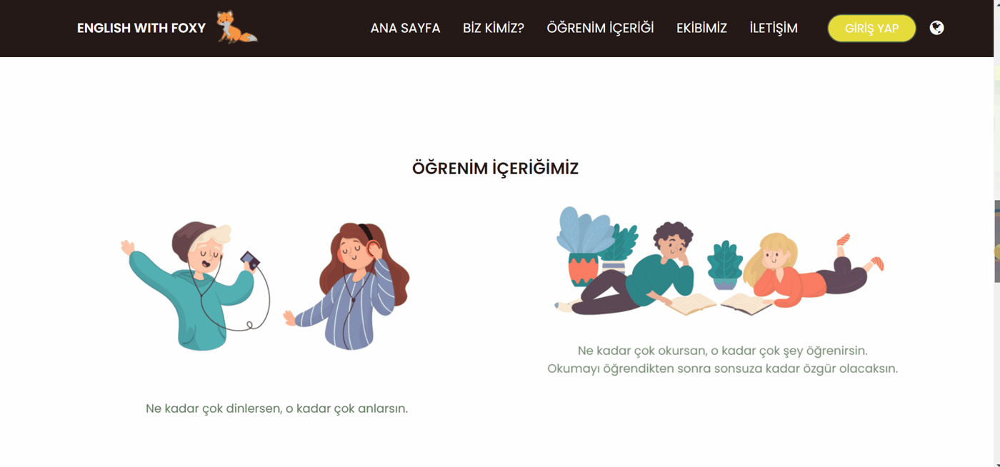
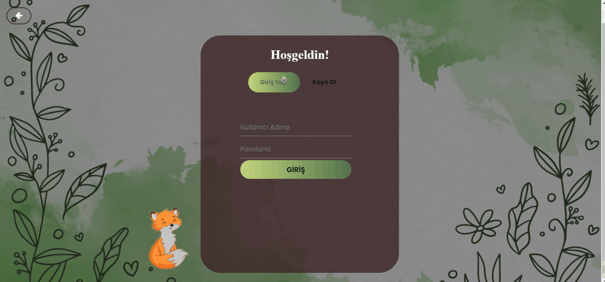

**Repo orijinal tarihi:** 19.05.2022

---

# English-With-Foxy
TÜBİTAK 2242 Proje Yarışması English With Foxy Web Sitesi

Bu repo, **TÜBİTAK 2242 Üniversite Öğrencileri Araştırma Proje Yarışmaları** kapsamında geliştirdiğimiz *English With Foxy* projesinin web sitesini içermektedir.

## PROJE HAKKINDA

English With Foxy, 6-16 yaş arasındaki çocuklara **tamamen ücretsiz ve online** İngilizce eğitimi vermeyi amaçlayan bir projedir. Dersler, ileri düzeyde İngilizce bilgisine sahip **gönüllü üniversite öğrencileri** tarafından verilmektedir.

Derslerin amacı çocukların gramer bilgisinin yanında *okuma, yazma, dinleme* ve *konuşma* becerilerini de geliştirmektir.

Web sitesi üzerinden çocuklar sisteme kayıt olabiliyor, kendilerine uygun ders programını seçebiliyor ve quizler ile öğrendiklerini pekiştirebiliyorlar.

## SİTENİN BÖLÜMLERİ

### Ana Sayfa

Siteye girildiğinde Foxy'nin animasyonu ile karşılaşılıyor, ardından ana sayfa açılıyor. Buradan *Kayıt Ol* butonu ile eğitimlere katılım sağlanabiliyor.

### Biz Kimiz?

Projenin misyonunun ve ekibin nasıl çalıştığının anlatıldığı bölüm.

### Öğrenim İçeriği

Derslerde geliştirilmesi hedeflenen dinleme, okuma, konuşma ve yazma becerilerinin tanıtıldığı bölüm.

### Giriş Yap / Kayıt Ol

Kullanıcıların sisteme kayıt olup giriş yapabildiği sayfa. Giriş yapan kullanıcı kendi sayfasına yönlendiriliyor. Bu sayfada:

- İki farklı ders programından kendisine uygun olanı seçebiliyor,
- Quizler ile öğrendiklerini test edebiliyor,
- İngilizce ile ilgili eğlenceli bilgilere (fun facts) göz atabiliyor.

Site Türkçe ve İngilizce olmak üzere iki dilde hazırlanmıştır. Sağ üstteki dünya simgesi ile diller arasında geçiş yapılabiliyor.

## KULLANILAN TEKNOLOJİLER

| Alan | Teknoloji |
|---|---|
| Arayüz | HTML, CSS, JavaScript |
| Sunucu tarafı | PHP |
| Veritabanı | MySQL |

## DOSYA YAPISI

- `index.html`: Foxy animasyonunun gösterildiği açılış sayfası
- `index1.html` / `index2.html`: Türkçe ve İngilizce ana sayfalar
- `kayitgiris.php`: Kayıt olma ve giriş yapma işlemleri
- `homepage.php`: Giriş yapan kullanıcının sayfası (ders programları, quizler, fun facts)
- `actionbir.php` / `actioniki.php`: Ders programı seçimi
- `logout.php`: Çıkış işlemi
- `css/`, `js/`, `images/`: Stil dosyaları, scriptler ve görseller
